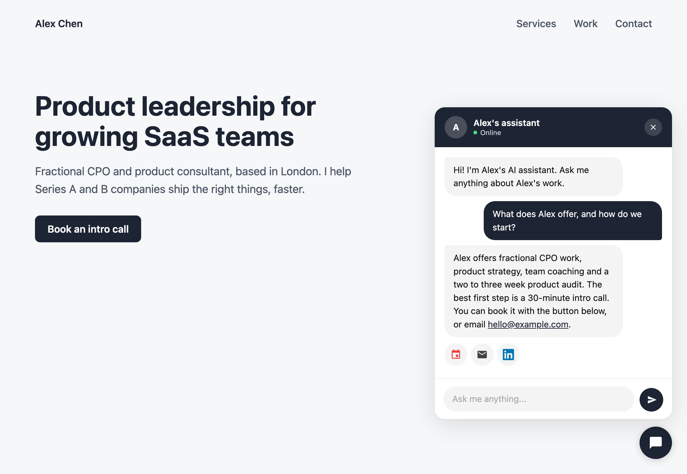
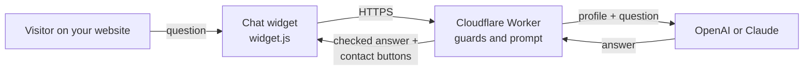

<h1 align="center">Portfolio Chatbot</h1>

<p align="center">
  <strong>An open-source AI chatbot for your website that answers visitors from your own profile.</strong><br>
  For freelancers, consultants, developers and small businesses. One script tag to embed. Runs on Cloudflare Workers with OpenAI or Claude.
</p>

<p align="center">
  <a href="LICENSE"></a>
  
</p>

<p align="center">
  <a href="#features">Features</a> ·
  <a href="#how-it-works">How it works</a> ·
  <a href="#quick-start">Quick start</a> ·
  <a href="#security-model">Security</a> ·
  <a href="#cost">Cost</a>
</p>

<p align="center">
  
  <br>
  <sub>The widget on a sample site, using the fictional profile in <code>setup/examples/</code>. The reply shown is an example.</sub>
</p>


## Features

* **Answers from your profile.** You write a few Markdown files about yourself. The bot is instructed to answer only from them, and to tell visitors when the answer is not there.
* **Guardrails built in.** Prompt-injection checks, topic limits, origin and token checks, per-visitor rate limits, and a reply check that stops the bot from quoting its own instructions.
* **One line to embed.** Paste a script tag into any website that lets you add one, including React and Next.js sites. The widget uses Shadow DOM, so it never clashes with your styles.
* **Turns questions into leads.** When a visitor asks how to work with you, the bot shows your contact buttons: email, calendar, LinkedIn, WhatsApp and more.
* **OpenAI or Claude.** Use `gpt-6-luna` or `claude-haiku-5-5` by default, or any model you choose.
* **Cheap to run.** Cloudflare's free tier covers the hosting. You pay only for the AI messages.
* **Your data stays yours.** Your profile and keys are encrypted Cloudflare secrets. The worker does not log or store chat messages; its logs record only blocked requests (with the visitor's IP address or website). Your AI provider handles messages under its own data policy.


## How it works



1. The widget sends the visitor's question to your Cloudflare Worker.
2. The worker checks the request: allowed website, widget token, rate limit, size, and prompt-injection phrases.
3. The worker sends your profile and the question to the AI, with rules that limit it to your profile.
4. The worker checks the answer, adds contact buttons when the visitor wants to get in touch, and sends it back.


## Before you start

You need:

* A Cloudflare account (free tier is enough). Sign up at cloudflare.com.
* An API key from OpenAI or Anthropic. See [Getting an API key](#getting-an-api-key) below.
* Node.js 22 or newer. Check by running `node --version` in your terminal.
* Python 3. Check by running `python3 --version`. Comes preinstalled on macOS and most Linux systems.


## Quick start

1. On GitHub, click **Use this template**, then **Create a new repository**.
2. Clone your new repository and run the setup wizard. Replace `YOUR_USERNAME` with your GitHub username:

   ```bash
   git clone https://github.com/YOUR_USERNAME/portfolio-chatbot.git
   cd portfolio-chatbot
   bash scripts/setup.sh
   ```

The wizard walks you through every setting, checks your Cloudflare connection, helps you store your API key, and offers to deploy when you finish. Everything is saved to `setup/config.json` on your machine and is never committed. Run it again any time to change a setting.

Setup takes about 15 minutes. The steps below explain what the wizard does, if you prefer to set up by hand.


## Everything you configure lives in one folder

```
setup/
  config.json       your settings (name, contact methods, colours)
  profile/
    about.md        who you are and what you do
    contact.md      how visitors can reach you
    services.md     what you offer (optional)
    ...
```

The bot answers only from the `.md` files in `setup/profile/`. You fill in the `setup/` folder. The rest is code you do not need to touch.


## Step 1: Download

Create your copy with **Use this template**, then clone it, as in the [Quick start](#quick-start). If you used the wizard, you can skip Steps 2 and 3: it does them for you.


## Step 2: Connect to Cloudflare

```bash
cd worker && npx wrangler login
```

This opens a browser tab. Log in to your Cloudflare account and click Authorize. This grants Wrangler permission to create and deploy Workers in your account. You only do this once.


## Step 3: Store your API key

If you do not have an API key yet, see [Getting an API key](#getting-an-api-key) below first.

```bash
cd worker && npx wrangler secret put LLM_API_KEY
```

Paste your API key when prompted and press Enter. Wrangler sends it to Cloudflare, where it is encrypted and stored securely. It is never in your code or files and cannot be read back: not even by you.


## Step 4: Fill in your details

If `setup/config.json` does not exist yet, copy it from `setup/examples/config.json` first.

Open `setup/config.json` in any text editor. Fill in at minimum:

```json
{
  "botName": "Sarah's Bot",
  "ownerName": "Sarah Johnson",
  "contactMethods": {
    "email": "hello@yourdomain.com",
    "linkedin": "https://linkedin.com/in/yourhandle"
  },
  "security": {
    "allowedOrigins": [
      "https://yourdomain.com",
      "https://www.yourdomain.com"
    ]
  }
}
```

`allowedOrigins` lists the websites that may use your bot: include both the `www` and non-`www` versions. A trailing slash does not matter. Browser requests from other websites are blocked. If the list is empty, every website is allowed: fine for testing, not for going live.

Then write your profile in `setup/profile/`. If the folder does not exist yet, copy the examples:

```bash
mkdir -p setup/profile && cp setup/examples/*.md setup/profile/
```

Each example file starts with a `PORTFOLIO-CHATBOT-EXAMPLE` line. Replace the content with your own, then delete that line. The deploy script skips any file that still has it. At minimum, fill in `setup/profile/about.md` and `setup/profile/contact.md`.

See [All configuration options](#all-configuration-options) and [Profile files](#profile-files) below for everything you can set.


## Step 5: Deploy

```bash
bash scripts/build-and-deploy.sh
```

The script handles everything automatically:

1. Installs worker dependencies if not already installed
2. Copies the example profile files into `setup/profile/` if the folder is empty, so you can edit them
3. Checks Cloudflare authentication and tells you what to do if not connected
4. Checks that `LLM_API_KEY` is set, and creates the widget token (`WIDGET_TOKEN`) for you
5. Reads all `.md` files from `setup/profile/` and combines them into your profile
6. Uploads your profile and config to Cloudflare as encrypted secrets (they never go into git)
7. Deploys the chat worker, and the widget worker that hosts `widget.js` and a standalone chat page

The worker names come from `worker/wrangler.toml` (`portfolio-chatbot-worker`) and `widget-worker/wrangler.toml` (`portfolio-chatbot-widget`). They become part of your URLs, for example `https://portfolio-chatbot-worker.YOUR-ACCOUNT.workers.dev`. If you want different names, change them before your first deploy: renaming later changes the URLs and breaks existing embeds.

The widget token is saved in `setup/config.json`. If you already set `WIDGET_TOKEN` yourself, the script asks you to paste it instead of replacing it.

**Updating later:** whenever you edit files in `setup/`, run `bash scripts/build-and-deploy.sh` again. The worker is updated live within about 30 seconds.


## Step 6: Add the widget to your website

When the deploy finishes, open `setup/embed.html` in a browser. It has the exact snippet for your site, with your URLs and token filled in. It looks like this:

```html
<script src="https://portfolio-chatbot-widget.YOUR-ACCOUNT.workers.dev/widget.js"
        data-worker="https://portfolio-chatbot-worker.YOUR-ACCOUNT.workers.dev"
        data-token="YOUR_WIDGET_TOKEN"
        defer></script>
```

Paste it just before the `</body>` tag of your pages and publish your website. The widget appears as a floating button in the bottom-right corner of the page.

The name, welcome message, accent colour and suggested questions come from `setup/config.json`. You can also override them on the script tag:

| Attribute | What it does |
|---|---|
| `data-name` | Name displayed in the chat header |
| `data-accent` | Accent colour, for example `#0055ff` |
| `data-welcome` | First message visitors see when they open the widget |
| `data-accent-text` | Colour of text and icons drawn on the accent colour. Default `#fff`. Use a dark colour if your accent is light |
| `data-accent-ink` | Colour of links and suggestion buttons on the white panel. Defaults to the accent colour |

To open the chat from your own button or link, send this event from the page once the widget has loaded (for example when a visitor clicks your button):

```js
window.dispatchEvent(new Event('portfolio-chatbot:open'))
```

For React or Next.js sites, `setup/embed.html` also has a ready React component.


## Getting an API key

**OpenAI (default):**
Log in at platform.openai.com, go to API keys, and create a new secret key. The default model is `gpt-6-luna`: cheap and fast.

**Anthropic Claude:**
Log in at console.anthropic.com, go to API keys, and create a key. To use it, set `"llm": { "provider": "anthropic" }` in your `setup/config.json`. The default model is `claude-haiku-5-5`: cheap and fast.

Both work equally well for this use case. If you are not sure, start with OpenAI.


## Profile files

Profile files live in `setup/profile/`. Everything in `setup/` except `setup/examples/` is gitignored: it stays on your machine and is never committed. See `setup/examples/` for filled-in examples using a fictional persona.

| File | What to write |
|---|---|
| `about.md` | Who you are, background, career history: required |
| `contact.md` | Contact methods, when and how to use them: required |
| `services.md` | What you offer, who you work with |
| `experience.md` | Roles, industries, tools, years of experience |
| `faq.md` | Questions you get asked often, pre-answered |
| `boundaries.md` | Topics the bot must never claim or discuss |

Any additional `.md` files you add to `setup/profile/` are included automatically on the next deploy. Non-English text and large profiles are fine: the profile is uploaded in as many pieces as it needs.


## All configuration options

Edit `setup/config.json`. Every field has a default, but always set `botName` and `ownerName`: the defaults are generic.

**Identity**

| Field | Default | Description |
|---|---|---|
| `botName` | `"Assistant"` | Name shown in the widget header |
| `ownerName` | `"the professional"` | Used in the bot's replies and fallback messages |
| `tone` | `"professional"` | Writing style: `professional` `casual` `direct` `warm` `technical` `formal` `founder` |
| `maxAnswerWords` | `80` | Target reply length in words |
| `historyTurns` | `4` | How many previous message pairs the bot remembers in one session |
| `allowedTopics` | `[]` | Keywords the bot is allowed to discuss. Empty means allow anything from the profile. |
| `blockedTopics` | `[personal life, politics, ...]` | Keywords the bot will refuse. Setting this replaces the default list entirely. |

**Contact methods**

All optional. Only the methods you configure get shown as buttons.

| Field | Example | Notes |
|---|---|---|
| `contactMethods.email` | `"hello@yoursite.com"` | |
| `contactMethods.linkedin` | `"https://linkedin.com/in/yourhandle"` | Full URL |
| `contactMethods.whatsapp` | `"447000000000"` | Country code + number, digits only |
| `contactMethods.sms` | `"447000000000"` | Same format as WhatsApp |
| `contactMethods.calendar` | `"https://cal.com/yourname/intro"` | Full URL to your booking page |
| `contactMethods.github` | `"https://github.com/yourhandle"` | Full URL |
| `contactMethods.custom` | `[{ "label": "Portfolio", "href": "https://..." }]` | Any extra links |

**LLM provider**

| Field | Default | Description |
|---|---|---|
| `llm.provider` | `"openai"` | `openai` or `anthropic` |
| `llm.model` | `null` | Leave null to use the provider default. OpenAI: `gpt-6-luna`. Anthropic: `claude-haiku-5-5`. |

**Security**

| Field | Default | Description |
|---|---|---|
| `security.allowedOrigins` | `[]` | Websites allowed to use your worker, e.g. `https://yoursite.com`. Empty means every website: not recommended when live. When the list is not empty, the deploy script adds the widget's standalone page to it. |
| `security.rateLimitRpm` | `10` | Max requests per visitor per minute, counted by each copy of the worker. The shared limit across all copies is set in `worker/wrangler.toml` (`CHAT_RATE_LIMITER`, also 10 per minute). |
| `security.maxMessageLength` | `500` | Max characters in a visitor message. The widget uses the same limit. |
| `security.maxSessionMessages` | `20` | Max history messages the widget may send with one request |

**Widget appearance**

| Field | Default | Description |
|---|---|---|
| `ui.accentColor` | `"#0055ff"` | Button and icon colour |
| `ui.accentTextColor` | `null` | Text and icon colour on the accent colour. `null` means white. Use a dark colour if your accent is light |
| `ui.welcomeMessage` | auto | First message the visitor sees |
| `ui.suggestedQuestions` | `[]` | Quick-reply buttons shown below the welcome message |


## Local development

1. Put your API key in `worker/.dev.vars` (this file is gitignored):

   ```
   LLM_API_KEY=your-key
   ```

   To test without an API key, use this line instead. The bot then gives test replies and calls no AI:

   ```
   LLM_MOCK=1
   ```

2. Start the worker with your real `setup/` files:

   ```bash
   bash scripts/dev.sh
   ```

3. Open `widget/dev.html` in a browser. It talks to the worker at `http://localhost:8787`.

Locally, the widget token and origin checks are off, so you can test freely. Use `bash scripts/dev.sh --port 8788` if port 8787 is taken.


## Security model

* All secrets are encrypted Cloudflare Worker secrets: never in source code or git history
* `WIDGET_TOKEN` and `allowedOrigins` stop other websites from embedding your bot. They do not stop a determined person: the token is visible in your page source, and scripts outside a browser can send any `Origin` header
* A per-visitor rate limit slows down abuse: 10 messages per minute by default, shared by all copies of the worker in a Cloudflare location (Cloudflare's rate limiting binding, set in `worker/wrangler.toml`). It is approximate by design, and there is no overall spending cap, so also set a monthly budget limit with your AI provider
* Every visitor message, and the chat history the browser sends with it, is checked before reaching the AI: size, prompt-injection phrases, topic keywords. Hidden characters that could hide an attack are removed first
* The system prompt enforces strict context boundaries as a second layer
* Replies are length-capped before being sent back to the visitor. A reply that quotes the bot's own instructions is replaced with the fallback answer
* The bot says it is an AI assistant representing you, not you, if a visitor asks
* Conversation history is in memory only: never logged, never persisted


## Cost

* Cloudflare Workers free tier: 100,000 requests per day
* The widget worker that hosts `widget.js` is covered by the same free tier
* OpenAI `gpt-6-luna` or Anthropic `claude-haiku-5-5`: both charge $0.10 per million input tokens and $0.50 per million output tokens
* Each message sends your profile and the recent chat to the AI, and the model thinks briefly before it answers (billed as output). So a message costs about $0.0003 to $0.001 with a typical profile. That is roughly $0.30 to $1 per 1,000 messages. A bigger profile costs more
* With Anthropic, a profile of a few hundred words or more is cached for about 5 minutes. Later messages in the same chat then cost less, and the first one costs a little more

For example, 300 visitors a day who each send 3 messages is about 27,000 messages a month: roughly $8 to $27 a month in AI costs, with hosting free. Set a monthly budget limit with your AI provider so a spike can never surprise you.


## Project structure

```
portfolio-chatbot/
  setup/
    examples/       filled-in example files (fictional persona, safe to share)
    config.json     your config (gitignored)
    profile/        your profile .md files (gitignored)
  worker/
    src/
      index.js      routing, LLM calls, CTA logic
      config.js     config loading and defaults
      prompt.js     system prompt builder
      guards.js     input validation and output sanitisation
    test/           unit tests (npm test)
    package.json
    wrangler.toml
  widget/
    widget.js       the embeddable chat widget (Shadow DOM, no dependencies)
    dev.html        local test page
    index.html      standalone chat page (generated at deploy, gitignored)
  widget-worker/
    wrangler.toml   hosts widget.js and the standalone page on Cloudflare
  scripts/
    setup.sh              setup wizard
    build-and-deploy.sh   deploy to Cloudflare
    dev.sh                run the worker locally
  docs/             screenshot and social preview image
  .github/          CI: unit tests and script checks on every pull request
  README.md
  SECURITY.md       how to report a security problem
```
